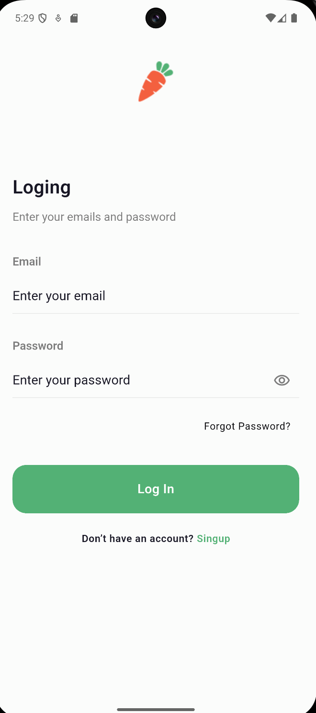
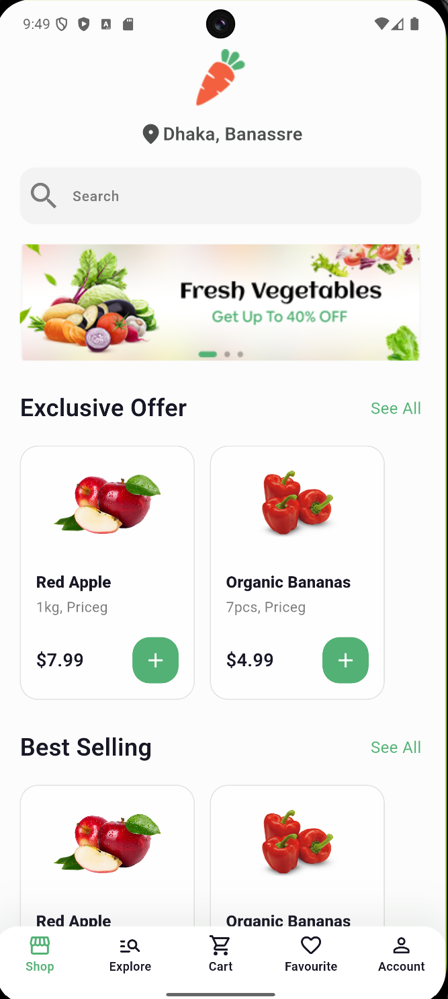
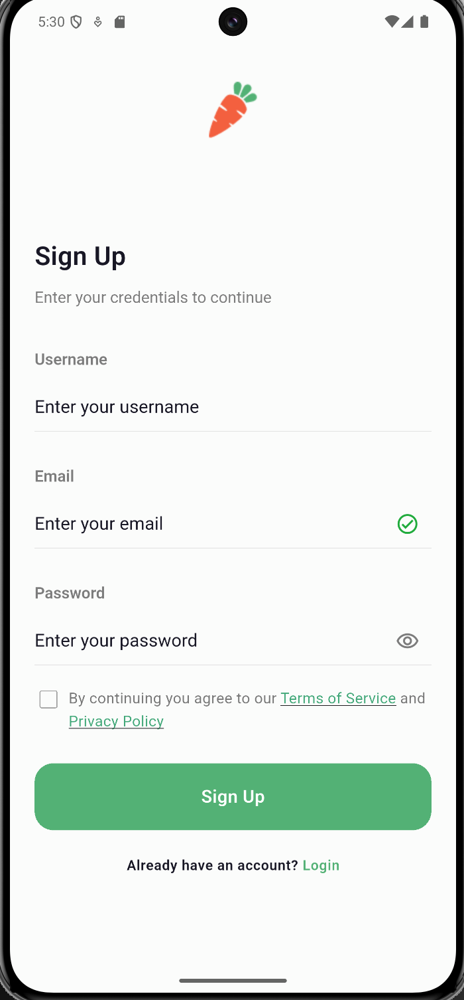

# 🛒 Groceries App

A Flutter application project for a grocery shopping experience. This
repository currently includes the app's authentication screens: **Log
In** and **Sign Up**.

## 📱 App Screens

- LOGIN

- SIGNUP

- HOME

- ITEM DET

- EXPLORE

- SLET ITEM IN EXP

- FILTER SCREEN

- CART SCREEN

- FAV SCREEN  

- PROFILE SCREEN

**Screen elements:** - Username input field. - Email input field. -
Password input field with a visibility control. - Terms of Service and
Privacy Policy notice with a checkbox. - **Sign Up** button. -
Navigation link back to the Log In screen for existing users.

## 🧰 Built With

- [Flutter](https://flutter.dev/) --- UI toolkit for building
    cross-platform applications.
- [Dart](https://dart.dev/) --- Programming language used by Flutter.

## 🚀 Getting Started

Follow these steps to run the project locally.

### Prerequisites

Make sure you have the following installed:

- [Flutter SDK](https://docs.flutter.dev/get-started/install)
- [Dart SDK](https://dart.dev/get-dart) (included with Flutter)
- An IDE such as [Android
    Studio](https://developer.android.com/studio) or [Visual Studio
    Code](https://code.visualstudio.com/)
- An emulator, simulator, or physical device

### Installation

1. Clone this repository:

    ``` bash
    git clone <YOUR_REPOSITORY_URL>
    ```

2. Open the project folder:

    ``` bash
    cd groceries_app
    ```

3. Install the project dependencies:

    ``` bash
    flutter pub get
    ```

4. Run the application:

    ``` bash
    flutter run
    ```

## 📂 Project Structure

A typical Flutter project structure looks like this:

``` text
groceries_app/
├── android/
├── ios/
├── lib/
│   └── main.dart
├── test/
├── assets/
│   └── screenshots/
│       ├── login.png
│       └── signup.png
├── pubspec.yaml
└── README.md
```

Your actual project structure may differ depending on how the
application is organized.

## 📚 Useful Resources

If this is your first Flutter project, these resources can help you get
started:

- [Learn Flutter](https://docs.flutter.dev/get-started/learn-flutter)
- [Write Your First Flutter
    App](https://docs.flutter.dev/get-started/codelab)
- [Flutter Learning
    Resources](https://docs.flutter.dev/reference/learning-resources)
- [Flutter Documentation](https://docs.flutter.dev/)

## 📝 Notes

- Replace `<YOUR_REPOSITORY_URL>` with your Git repository URL.
- Add your screenshots to `assets/screenshots/`, or update the image
    paths in this README to match where you store them.
- Update this README as you add more screens and features to the
    application.

------------------------------------------------------------------------

## Made with Flutter 💙
